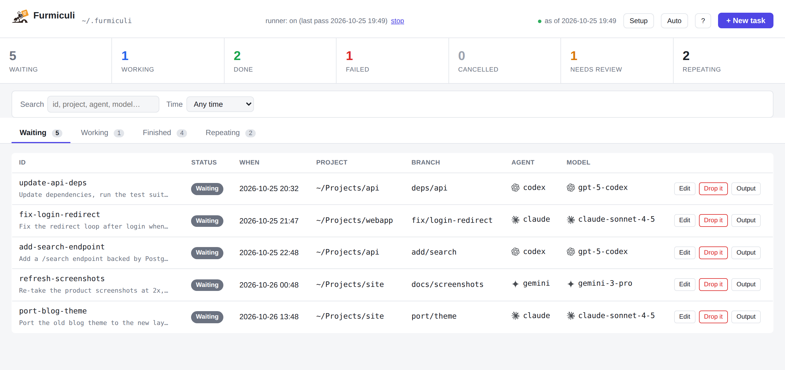

<p align="center">
  
</p>

# furmiculi

[](https://github.com/giannileggio/furmiculi/actions/workflows/ci.yml)
[](https://github.com/giannileggio/furmiculi/releases)
[](LICENSE)

Queue and run coding-agent tasks defined as Markdown files. A colony of
agents, one file each.

*Furmiculi* means "ants" in Sicilian: lots of small workers, each carrying one
task, getting the job done while you're away.

- **A queue made of plain Markdown files.** A task is a `.md` file: YAML
  frontmatter says where and how to run (repo, branch, worktree, agent, model,
  schedule...), and the body is the prompt. Status lives in the file and
  finished tasks move to `archive/`, so the queue is greppable, versionable and
  has no database. Write tasks by hand, with `furmi add`, or ask an agent to.
- **Any agent, and plain commands too.** Presets for Claude Code, Codex,
  Gemini CLI, Hermes Agent, opencode and Pi are built in, and others are a few
  lines of config. A task can also be a plain shell command (`--run`), and a
  cron schedule turns any task into recurring work ("every night..."). Tasks run
  unattended in tmux, each in its own worktree, and can open a PR when done.
- **One colony across all your machines.** `furmi node add` registers another
  box over plain SSH, with no cluster, cloud service or extra auth. One
  dashboard then shows every machine's queue and lets you queue and manage tasks
  on any of them. Installing is one line, and `furmi doctor` says what's missing.
- **Drafts and templates.** A task can be saved as a draft, which waits for you
  to queue it, and any task can be kept as a template to start new ones from.

<p align="center">
  <picture>
    <source media="(prefers-color-scheme: dark)" srcset="assets/dashboard-dark.png">
    
  </picture>
</p>

Because the format is plain Markdown, you can write tasks by hand, with
`furmi add`, or by asking an agent: open it in `~/.furmiculi` and say "add a
task to fix the login redirect in ~/Projects/myapp tonight, open a PR".
`furmi init` puts an `AGENTS.md` and a `furmi-tasks` skill there, which teach
the agent to write a self-contained prompt and queue it with `furmi add`. It
can also link the skill into your global skill folders, so you can queue work
from any repo.

## Quick start

Install (Linux or macOS; needs git and tmux):

```sh
curl --proto '=https' --tlsv1.2 -LsSf https://raw.githubusercontent.com/giannileggio/furmiculi/main/install.sh | sh
```

It ends by asking whether to let your coding agents queue tasks from any repo.

Then queue some work, from inside your project, and run it:

```sh
cd ~/Projects/myapp
furmi add "Fix the redirect loop after login"
furmi start                 # starts the runner and opens the dashboard; add -d to leave it in the background
```

That's all: the first command you run sets up `~/.furmiculi` and picks the
coding agent it finds on your `PATH`, and `furmi add` works on the git repo
you're standing in. In the dashboard, **+ New task** queues more work (once or
on a schedule), **Start the runner** turns it on, and **Setup** helps you pick
and install a coding agent and says what else is missing, all without the
terminal. No agent installed yet? `furmi agents` lists them with install
commands. Run `furmi` on its own any time to see where things stand and what
to try next, and `furmi doctor` if something isn't running.

## Platform

Linux and macOS (x86_64 and arm64). There is no Windows build: furmi shells out
to tmux and uses Unix signals.

## Install

```sh
curl --proto '=https' --tlsv1.2 -LsSf https://raw.githubusercontent.com/giannileggio/furmiculi/main/install.sh | sh
```

That script runs the release installer for this platform, then asks whether to
also make the `furmi-tasks` skill available in every project, so agents can
queue work from any repo. Say no and `furmi init --global-skill` does it later;
`FURMI_NO_SKILL=1` skips the question for scripted installs.

`furmi init` is optional after that: the first `furmi add`/`furmi start` sets up
`~/.furmiculi` by itself (override with `$FURMI_HOME` or `--home`).

### Install for your agent

The curl installer above is the recommended path: it installs `furmi` and
offers to link the `furmi-tasks` skill into your agents' global skill folders
(Claude Code, Codex, opencode, Pi and others), so you can queue work from any
repo.

If you'd rather get just the skill, for any agent supported by
[`skills`](https://github.com/vercel-labs/skills):

```sh
npx skills add giannileggio/furmiculi
```

The skill tells the agent to install `furmi` if it's missing. Running
`furmi init` later refreshes the skill to match your installed version.

Prebuilt binaries are published for Linux and macOS (x86_64 and arm64); the
script above fetches the right one and puts `furmi` on your `PATH`. `furmi`
then prints a one-line notice when a newer release is out (set
`FURMI_NO_UPDATE_CHECK=1` to turn that off), and `furmi update` installs it.

Every release carries `sha256.sum` and GitHub Artifact Attestations, so a
download can be checked before it runs: `gh attestation verify <file> --repo
giannileggio/furmiculi`.

Upgrading only works for installs the installer made: it is what leaves the
install receipt `furmi update` reads to find and replace this binary. A
`cargo install` or a from-source build upgrades the way it was installed. The
releases are public, so `furmi update` needs no credentials; it signs in with
a `GITHUB_TOKEN` (or `GH_TOKEN`) when one is set, or with whatever `gh` is
signed in as, which only lifts GitHub's anonymous rate limit.

Building from source instead:

```sh
cargo install --path .
```

## Usage

```sh
furmi add "Fix the redirect loop after login"   # in the repo you're in; asks if you leave the text out
furmi add --repo ~/Projects/myapp --on-finish pr --in 2h \
       "Fix the redirect loop after login"
echo "Update deps and run tests" | furmi add --repo ~/Projects/myapp --agent codex
furmi add --scratch "Compare the three queue libraries and write up a summary"   # no project
furmi add --repo ~/Projects/myapp --run "./scripts/backup.sh"   # a shell command, no agent (see below)
furmi add --draft "Fix the redirect loop"   # saved, not queued: look it over first
furmi queue <id>        # ...then let the runner have it (--in 2h / --at ...)
furmi duplicate <id>    # copy any task into a new draft
furmi template ls       # tasks to start new ones from (a few come with furmi)
furmi template save <task>   # keep a task as a template
furmi add --template review-the-diff --repo ~/Projects/myapp   # a task from one

furmi start             # the runner and the dashboard together (--no-open: no browser)
furmi start -d          # ...in the background: prints the URL and returns
furmi stop              # stop the dashboard and the runner (work already underway keeps going in tmux)
furmi restart           # stop them and start them again the way they were started, on the installed binary
furmi agents            # which coding agents are installed, and how to install the rest
furmi agents use codex   # make one the default for new tasks
furmi models            # what each configured agent's CLI says it can run (--agent name: one)
                        # and why: no models_cmd, a failed command, the cached answer
furmi models --refresh  # ask the CLIs again and rewrite models-cache.json, the
                        # list the dashboard's Model box offers

furmi ls                # queue
furmi ls --schedules    # schedules with their next run
furmi ls --archive      # finished tasks
furmi ls --watch        # ...live, every --interval (default 2s); in a terminal it's
                        # interactive: j/k move, l logs, d/f/c done/fail/cancel (asks
                        # first), r retry, a attach, tab queue/archive, q quit
furmi validate          # check every task and schedule file

furmi schedule add --cron "0 2 * * *" "update deps"   # same options as add, plus --allow-overlap
furmi schedule add --cron "0 3 * * *" --run "./scripts/backup.sh"   # ...a command, on a schedule
furmi schedule ls       # same as ls --schedules
furmi schedule edit <id> --cron "0 3 * * *"   # changes only the options you give
furmi schedule pause <id>    # stop firing, keep the file (resume <id> undoes it)
furmi schedule delete <id>   # tasks it already queued stay

furmi run               # run the queue until Ctrl-C (rescans every poll_interval)
furmi run --once        # one pass: enqueue due schedules, reap finished tasks, start new ones
furmi attach [id]       # watch running tasks in tmux, one window each
furmi logs <id>         # print a task's output: live if running, else the saved log
furmi logs <id> --attempt 1   # an earlier attempt, instead of the latest

furmi done [id]         # finish a task: runs on_finish, archives it
furmi fail [id] -r why   # give up on it, without retrying
furmi cancel [id]       # drop a draft, pending or running task
furmi retry <id>        # requeue a failed/cancelled/needs_review task

furmi clean             # remove worktrees and scratch folders of done tasks (-n: dry run)
furmi clean --all --older-than 7d   # ...and of failed/cancelled ones, a week on
furmi clean --archive --all --older-than 30d   # ...and their archived task files/logs
furmi clean --all --remove-broken   # ...and worktrees whose repo moved or was deleted

furmi update            # install a new release over this one (--check: just ask)
furmi update --to 0.4.1 # ...a specific version, back to an earlier one included
furmi update --restart  # ...and furmi restart once it is in (never done unasked)

furmi pause             # hold the runner: nothing new starts, no schedule fires; running tasks carry on and finish (kept across restarts)
furmi resume            # undo furmi pause
furmi status            # is the runner alive? queue, failing schedules
furmi doctor            # check tmux/git/agents/config/task files; non-zero on problems
furmi service systemd   # units that keep the runner and the dashboard up (or: launchd)

furmi web               # dashboard at http://127.0.0.1:7433, until Ctrl-C
furmi web -d            # ...in the background, like `furmi start -d`
furmi web --setup       # change where it serves (asked once anyway, see below)
furmi web --port 8080   # a different port
```

Inside a task's window, `id` defaults to that task, so an interactive
session ends with a plain `furmi done`, run by you or by the agent.

`furmi run` starts each task in a window of the `furmi` tmux session, inside
`~/.furmiculi/worktrees/<id>` (a git worktree on the task's branch) unless
`worktree: false`. It respects `max_parallel` and `max_parallel_per_repo`
(counted per repository, however its path is spelled) and never runs two
`worktree: false` tasks in the same checkout at once. It retries failures
after `retry_delay`, kills attempts that exceed `timeout`, runs `on_finish`
on success, and moves finished tasks to `archive/`. Each attempt's output is
saved to `logs/<id>.<attempt>.log`.

`--run` (`run:` in the file) queues a plain shell command instead of an agent,
for the chores around the agents' work: it goes through `sh -c` with no prompt,
agent or model, and gets the same logs, `timeout`, `retries` and `on_finish`. It
runs in the repo folder itself unless you add `--worktree`, and commits nothing
unless you set `--on-finish`. See [docs/FORMAT.md](docs/FORMAT.md#command-tasks).

## Keeping it running

`furmi run` is a plain foreground process; `furmi service systemd` (Linux) or
`furmi service launchd` (macOS) prints unit files, with install instructions,
that start the runner and the dashboard at login and restart them if they
die. Only one runner per home is allowed. `furmi status` shows whether it's
alive and when its last pass was (it warns if the runner looks stuck), and
`furmi run` also appends to `runner.log` in the home folder.

`furmi pause` holds the runner without stopping it: no queued task starts and
no schedule fires, while running tasks are still reaped and finished (their
`on_finish` included). It is a `paused` file in the home folder, so it
survives a runner restart; `furmi status` and the dashboard header show it, and
`furmi resume` (or the header's **Resume** button) lifts it.

`furmi update` replaces the binary on disk, but a dashboard or runner already
running keeps executing the old one. Each records its version in its lock file,
so `furmi status` shows it and flags one older than the installed binary, and
`furmi update` ends by naming what is still behind instead of restarting it: an
update can run inside a task or a script. `furmi restart` (or
`furmi update --restart`) stops both and starts them again with the flags they
were started with; a token file is recorded by path, the token itself never is,
so a dashboard started with `--token` has to be restarted by hand. Running tasks
keep going in tmux and the new runner picks them back up. Under `furmi service`
it asks systemd or launchd to restart them instead. The dashboard header shows
the version serving the page, with each online machine's beside its name in the
sidebar, and a page left open across an upgrade offers a reload.

The runner also tidies up after itself, when it starts and then every hour:

- **Done on its own, and logged to `runner.log`:** it removes the worktree of a
  done task, trims each task's logs to its last 5 attempts, and requeues a task
  that failed because of the machine (tmux gone, agent not installed) once that
  has cleared, at most twice per task. A worktree goes only if git can inspect
  it, it is its own checkout and it has no uncommitted changes; otherwise it
  stays and the banner says why.
- **Reported in a dashboard banner:** what `furmi doctor` warns about, and
  anything the pass declined to do.
- **Only ever suggested:** deleting a merged `furmi/*` branch of an archived
  task. The banner lists the exact command to run.

While the runner is paused (`furmi pause`) the pass still reports but changes
nothing. Tune it in `config.toml`, or turn it off:

```toml
[housekeeping]
enabled = true
interval = "1h"
keep_attempts = 5  # log attempts kept per task
max_requeues = 2   # automatic requeues per task
```

What `furmi` does so that a bad day doesn't lose work:

- **Crash-safe state.** Task, schedule and exit files are replaced atomically,
  never left half-written.
- **Nothing can hang it.** `git`, `gh` and `tmux` calls have timeouts and
  can't prompt; `on_finish` (push, PR) runs outside the lock the other
  commands share, and waiting for that lock gives up after two minutes.
- **Reboots aren't failures.** A task whose tmux window vanished is requeued
  at once without using a retry. Headless output is streamed to the log file
  as it's produced, so it survives tmux dying too.
- **Timeouts really stop the agent**: SIGTERM to its process group, then
  SIGKILL.
- **Guard rails.** A schedule won't enqueue a new run while its last one is
  still queued (unless `allow_overlap: true`).
- **Safe git handling.** A reused worktree must belong to the repo, `furmi`
  won't switch your checkout's branch over uncommitted changes, and
  `on_finish: pr` won't open a second PR for a branch that has one.

`furmi web` serves a local dashboard (queue, running, archive, schedules and stats,
pushed live over SSE as it changes) — a Sidekiq-style view of the same state
`furmi ls` prints. **+ New task** queues work from a form (what to do, which
project, when to start, what to do with the result), calling the same code as
`furmi add`; `furmi start` is `furmi web` plus a runner that stops with it.
Either one with `-d`/`--detach` keeps serving in the background (it logs to
`~/.furmiculi/web.log`) and gives you the prompt back, so closing the terminal
changes nothing; `furmi stop` ends both. If the runner is off,
a banner says so with a **Start the runner** button (that runner keeps going
after you close the dashboard; `furmi stop` or the **stop** link next to
"runner: on" ends it), and **Setup** lists the coding agents (installed or not,
with the install command to copy, and **Use this one** to make one the default)
above what `furmi doctor` finds (tmux, git, task files), with a banner when
something needs attention. It's also where the runner's limits (tasks at once,
overall and per repo, and how often it rescans) and the task defaults (mode,
when-done, own worktree, retries, retry delay, timeout) are changed: they're
written into `config.toml`, and everything else in that file stays as it is. furmi doesn't run the installs for you: they're
`npm install -g` (or, for hermes, its own installer) commands and each agent
needs you to sign in once.

### Notifications

`furmi` can tell you when a task ends, through [ntfy](https://ntfy.sh), Telegram
or both. Add this to `config.toml`, keeping only the services you use:

```toml
[notify]
on = ["failed", "finished"]    # finished | failed | needs_review

[notify.ntfy]
url = "https://ntfy.sh"        # or the full topic URL, without `topic`
topic = "my-furmi"
token_file = "~/.furmiculi/ntfy-token"   # only for a protected topic

[notify.telegram]
bot_token_file = "~/.furmiculi/telegram-token"
chat_id = "123456789"
```

Nothing is sent unless `on` lists an ending and a service is configured.
`failed` means failed for good, once no retries are left, and `needs_review` is
an interactive session that ended without saying how it went. Marking a task
with `furmi done` or `furmi fail` counts too; a cancelled task sends nothing.

A message carries the task's id, repo, status, attempt count and error. When
`[web]` serves other machines under a name in `allowed_hosts`, it also links to
the task's dashboard page.

Secrets stay out of `config.toml` and tasks: they're read from those files, or
from `FURMI_NTFY_TOKEN` and `FURMI_TELEGRAM_BOT_TOKEN` when no file is set.
Sending needs `curl` on `$PATH`, gets 5 seconds, and can't hold up or fail a
task: an undelivered message is only logged. `furmi doctor` warns if the config
is incomplete or `curl` is missing.

### Serving your other machines (a tailnet)

By default `furmi web` and `furmi start` bind to 127.0.0.1 only. On a box
without a screen, the first `furmi web` asks whether to serve your other
machines instead, behind a bearer token and a `Host` allowlist (`--listen`,
`--token-file`, `--allowed-host`). It speaks plain HTTP: put `tailscale serve`
or an SSH tunnel (`ssh -L 7433:127.0.0.1:7433 your-box`) in front of it. See
[docs/REMOTE.md](docs/REMOTE.md) for the setup, the flags and the session cookie.
`furmi node add` (over SSH) shows several machines' queues in one dashboard, and lets you
queue and manage tasks on any of them (see the same page).

A task that is still *Waiting* has an **Edit** button: change what it does, the
project, when it starts, or what happens when it's done (not once it has
started: cancel it and add a new one). Its **Model** box is the same as
`furmi add --model`: empty means the agent's own model, and the suggestions are
the ones that agent's CLI names itself (`pi --list-models`, `opencode models`),
kept for an hour, plus any model a task of yours has already run with. `furmi
models` prints that same list, and why an agent has none, from a terminal
(`--refresh` asks the CLIs again and rewrites the cache). Agents
with no way to list models (claude, codex, gemini, hermes) get a box you can
type into and no suggestions, and an agent with no `model_args` gets no box at
all: it can't be handed a model. **+ New task** with "How often?" set to
anything but "Just once" creates a schedule, which appears under *Repeating*
with **Edit**, **Pause**/**Resume** and **Delete**. Changing a schedule's time or
resuming it starts counting from now, so it never fires for a slot that passed
meanwhile. The dashboard writes the same Markdown files you would, so
fields it doesn't show (`allow_overlap`, `retries`...) are kept.
The dashboard uses plainer words than the files do: *Waiting*, *Working*,
*Finished*, *Repeating*, *Needs review* (`pending`, `running`, the archive,
schedules, `needs_review`), and a failed task shows why it failed. Each task
row offers the buttons that make sense for its
status plus a log viewer, calling the same code as
`furmi done|fail|cancel|retry` and `furmi logs`: **Mark done** (runs the when-done
step), **Mark failed** (asks why, and doesn't retry) and **Try again** on a
finished task, **Edit** and **Drop it** while a task is still *Waiting*.
While something is *Working* the question is only whether it worked out —
both answers stop the agent — so **Drop it** isn't offered there; that would
mark something that ran as "cancelled". The **Agent** and **Model** columns
carry a mark for the tool and the model family (Claude, OpenAI, Gemini,
OpenCode, Qwen, DeepSeek, Meta, Mistral — a letter chip for anything else).
A model the task pins reads plain; one that came from somewhere else is
dimmed, with the source on hover: an agent's configured default, or what the
run itself reported (recorded as `model_used`), which is the only way to know
what a task that pins no model actually ran with. A run from before that was
kept still gets an answer when you open it: the view reads it out of the
attempt's log, saying where it found it.

Clicking a row opens the task behind it: the whole prompt, the workspace it
runs in, the agent, model and when-done step, the tokens it used, and the same
buttons the row carries. The id has a copy button in the row and in that view.
**Search** above the tables narrows them to what matches — id, ask, project,
branch, agent, model, and every word counts — and `Esc` clears it.

It reads like a list, too: `/` jumps to the search box, `1`–`4` switch tabs,
`j`/`k` walk the rows, `Enter` opens the highlighted one, `o` shows what the
agent printed, `n` queues a task, `Esc` backs out of whatever is open (and `?`
lists all of that). On a narrow screen each row becomes a card with its own
labels. The **Auto**/**Light**/**Dark** button in the header picks a theme:
*Auto* follows the operating system, and the choice is remembered in the
browser.

The numbers across the top are also a way around: click *2 Failed* and you
get the *Finished* list narrowed to failures (the count keeps counting
everything). A column header sorts the list by that column — *When* sorts on
the real timestamps, not on what it prints — and **Time** above the table
narrows it to the last hour, day, week or month, each list judged by its own
clock (when a task is due, when it started, when it finished); a task with no
time at all is *asap* and never hidden. A *Working* row counts up while you
watch it (`running 4m 12s`).
The log viewer shows an agent's JSON output (what the `claude` and `pi`
presets print) as the text it said and the tools it ran, with the raw bytes
one click away. While a task is still working, an open log follows it: it
re-reads the end of the agent's output (the last 100 KB, saying so) rather
than the whole thing, and hands back the scroll position if you scrolled up
to read something. Token usage isn't a column here: it only exists for
completed headless runs of agents that report it, which would be a column of
dashes pretending to be accounting. `furmi ls` shows what was reported, and so
does the task view.

It only binds to
`127.0.0.1`, so anyone who can reach it could already run `furmi` locally
themselves; there's no login. But a web page you visit can send requests to
`127.0.0.1` too, so the server only answers loopback `Host` names (against DNS
rebinding) and accepts actions only with a random per-run token that just the
dashboard page itself can read (against cross-site forgery). A task or
schedule file that can't be parsed shows up in a warning box instead of
breaking the page.

See [docs/FORMAT.md](docs/FORMAT.md) for the file formats.

## Contributing

Issues and pull requests are welcome; see [CONTRIBUTING.md](CONTRIBUTING.md).

Security problems are not issues: see [SECURITY.md](SECURITY.md).

## License

Apache-2.0. See [LICENSE](LICENSE).
